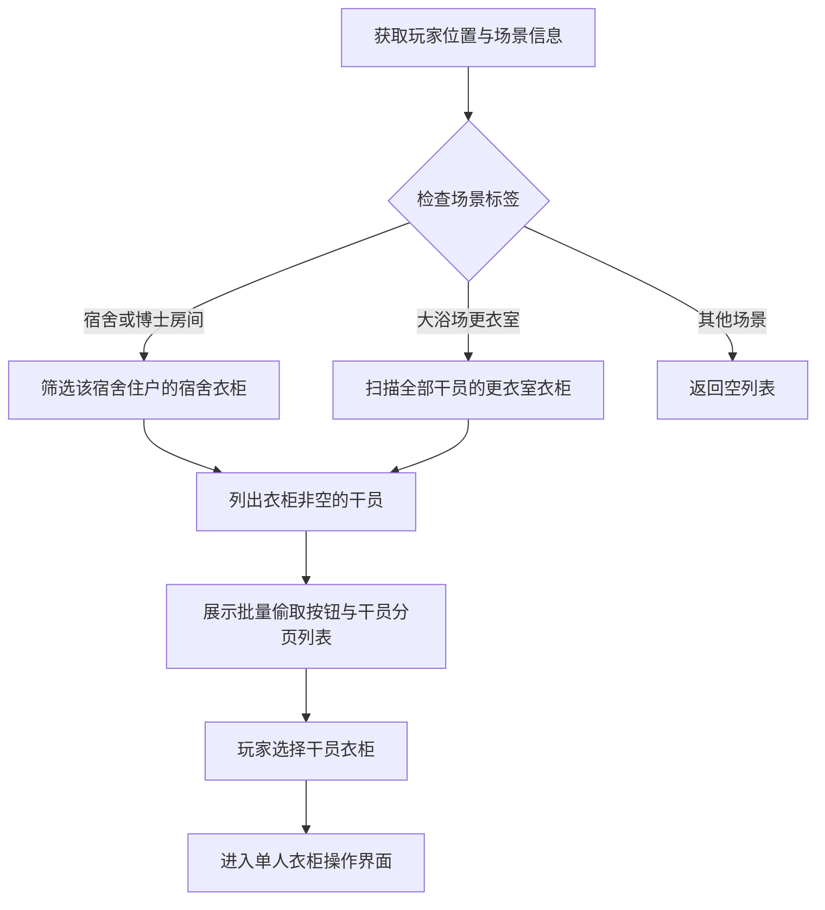
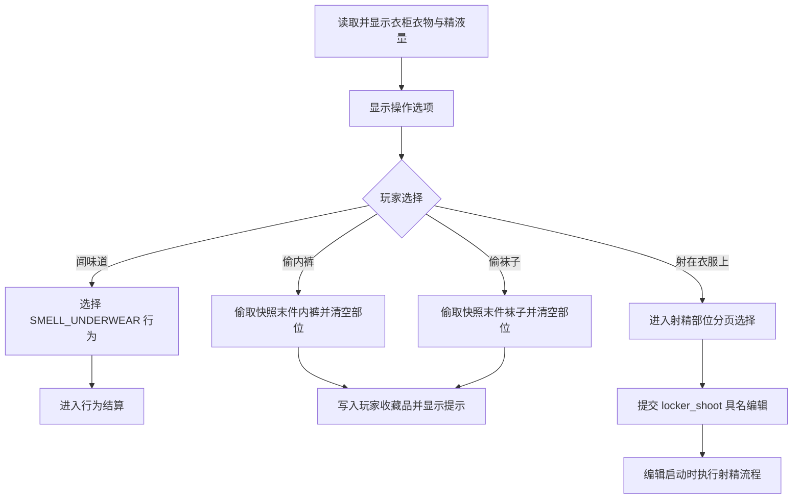

# 衣柜检查系统说明

## 系统概述

衣柜检查系统是 erArk 游戏中的一个功能模块，允许玩家检查和操作各个干员在不同地点（宿舍、大浴场更衣室、博士房间）衣柜中的服装物品，涵盖衣物查看、内裤与袜子偷取收藏、闻味道以及在衣物上射精等交互。

## 核心文件位置

- **界面面板**: `Script/UI/Panel/check_locker_panel.py`（主面板、分页按钮绘制、文案翻译与玩家交互循环）
- **后端服务**: `Script/Modules/gameplay_resolution/locker_service.py`（无界面的衣柜位置路由、归属扫描、偷取写入、内容/射精选项查询，以及具名编辑 `locker_shoot`）
- **衣柜路由工具**: `Script/Design/clothing.py`（`get_cloth_locker_type_by_scene`、`get_cloth_locker_by_type`、`empty_cloth_locker_part`）
- **数据结构**: `Script/Core/game_type.py`（`CLOTH`、`DIRTY` 类）与领域模块 `wardrobe`、`dirty`、`player_collection`
- **配置数据**: `data/csv/ClothingType.csv`、`data/csv/ClothingTem.csv`
- **射精系统**: `Script/Modules/gameplay_resolution/ejaculation_service.py`

## 系统架构

### 1. 界面类与服务职责

#### Check_locker_Panel（主面板类）
- **功能**: 管理衣柜检查的主界面，显示当前场景下衣柜非空的干员列表，并提供批量偷取所有内裤、批量偷取所有袜子及返回按钮
- **核心属性**:
  - `width`: 绘制宽度
  - `handle_panel`: 分页控制面板（`PageHandlePanel`），用于显示干员列表

#### FindDraw（干员衣柜按钮类）
- **功能**: 在分页列表中显示单个干员的衣柜按钮，点击后进入该干员的衣柜操作子界面（查看衣物与精液量、闻味道、偷内裤、偷袜子、射在衣服上）
- **核心属性**:
  - `npc_id`: 干员角色 ID
  - `character_data`: 干员身份数据
  - `locker_type`: 当前场景衣柜类型（2 为更衣室，3 为宿舍）
  - `now_locker`: 当前衣柜的可变快照字典（部位 ID 到衣物 ID 列表）

#### Ejaculation_NameDraw（射精部位按钮类）
- **功能**: 在射精部位选择分页列表中显示单个非空服装部位及其当前精液量，点击后提交具名编辑 `locker_shoot`
- **核心属性**:
  - `index`: 服装部位 ID
  - `npc_id`: 目标干员角色 ID
  - `locker_type`: 衣柜类型（2 为更衣室，3 为宿舍）
- **场景路由说明**:
  - 博士房间没有独立衣柜：开启同居服务时助理的宿舍地址指向博士房间（见 `assistant_panel.py`），在博士房间读取与写入的仍是她的宿舍衣柜
  - 衣柜类型判定与快照读取统一由 `Script/Design/clothing.py` 的 `get_cloth_locker_type_by_scene()` 与 `get_cloth_locker_by_type()` 完成，经 `locker_service` 供面板调用

#### locker_service（无界面后端服务）
- **只读查询**: `site_here()`、`locker_here()`、`owners()`、`has_part()`、`filled_parts()`、`contents()`、`shoot_option()`
- **写入操作**: `steal_all()`、`steal_last()`（在当前写缓冲中更新 `player_collection` 与 `wardrobe`）
- **具名编辑**: `shoot_args()` 构造参数字典，`@edits.edit("locker_shoot")` 注册的 `shoot_in_locker()` 在 0 分钟编辑启动时调用 `ejaculation_service.ejaculation_flow()`

### 2. 数据结构关系

#### CLOTH 类（`Script/Core/game_type.py`）
运行时通过领域模块 `wardrobe` 读写，衣柜相关字段如下：
- `cloth_locker_in_shower: dict[int, list]`：大浴场更衣室衣柜（部位 ID -> 衣物模板 ID 列表）
- `cloth_locker_in_dormitory: dict[int, list]`：宿舍衣柜（部位 ID -> 衣物模板 ID 列表）
- `cloth_wear: dict[int, list]`：当前穿着的服装
- `cloth_off: dict[int, list]`：当前脱下的服装

#### DIRTY 类（`Script/Core/game_type.py`）
运行时通过领域模块 `dirty` 读写，衣柜污浊字段如下：
- `cloth_locker_semen: dict`：衣柜中服装的精液情况，键为服装部位编号 `int`，值为 `[部位名 str, 当前精液量 int, 当前精液等级 int, 总精液量 int]`

## 系统流程

### 1. 衣柜检测流程（`Check_locker_Panel.draw()` -> `locker_service`）



#### 检测逻辑：
- `locker_service.site_here()` 依据玩家位置读取场景路径、场景数据与衣柜类型（含 `"Locker_Room"` 时为 2，其余为 3）
- `locker_service.owners(site)` 按 `roster.active()` 顺序遍历干员（跳过玩家 0）：
  - **宿舍 / 博士房间模式**: `scene_tag` 包含 `"Dormitory"` 或 `"Dr_room"` 时，检查干员宿舍地址是否等于当前场景路径且宿舍衣柜存在任意非空部位
  - **更衣室模式**: 否则 `scene_tag` 包含 `"Locker_Room"` 时，检查全部在编干员的大浴场衣柜是否存在任意非空部位，不按宿舍筛选
  - **其他场景**: 返回空列表
- `locker_service.has_part()` 检查当前列表干员在部位 9（内裤）或部位 10（袜子）是否有衣物，用于决定是否显示批量偷取按钮

### 2. 衣柜操作流程（`FindDraw.check_cloth()`）



## 关键功能实现

### 1. 收藏品获取机制

- **单件偷取（`FindDraw.get_pan` / `FindDraw.get_socks`）**：委托 `locker_service.steal_last(npc_id, locker_type, part, held)`。若面板持有的部位快照为空则直接返回且不写入；否则先按快照最后一件衣物 ID 查询模板名称（未知 ID 在写入前抛出 `KeyError`），再通过 `player_collection.append_list_map` 写入对应收藏字段（`npc_panties_tem` 或 `npc_socks_tem`），并调用 `clothing.empty_cloth_locker_part` 清空该部位。随后面板清空本地快照对应部位并用 `WaitDraw` 提示结果。
- **批量偷取（`Check_locker_Panel.steal_all_pan` / `steal_all_socks`）**：委托 `locker_service.steal_all(npc_ids, scene_tag, part)`。按传入干员顺序扫描指定部位，跳过不在服装模板表中的编号，清空所有非空部位，并在循环结束后统一调用一次 `player_collection.extend_list_map`（无收获时亦调用一次）。面板随后汇总每件衣物名称与总件数，通过 `WaitDraw` 展示。

### 2. 特殊行为与具名编辑

- **闻味道（`FindDraw.smell`）**：调用 `player_pick.choose(constant.Behavior.SMELL_UNDERWEAR, 1, target=self.npc_id, state=constant.CharacterStatus.STATUS_SMELL_UNDERWEAR)` 提交 1 分钟的闻内衣味道行为选择。
- **射在衣物上（`FindDraw.shoot_in_cloth` / `Ejaculation_NameDraw.shoot_here`）**：`FindDraw.shoot_in_cloth` 通过 `locker_service.filled_parts(self.now_locker)` 列出当前快照中所有非空部位；各部位按钮由 `locker_service.shoot_option` 实时读取衣柜衣物与精液量拼接文案。玩家选中部位后，`shoot_here` 清除当前命令并调用 `player_pick.commit_edit("locker_shoot", locker_service.shoot_args(part, locker_type, npc_id))`；0 分钟编辑开始执行时，由 `locker_service.shoot_in_locker` 调用 `ejaculation_service.ejaculation_flow(part_cid=..., part_type=..., target_character_id=..., draw_flag=True)` 完成精液掷骰与射精结算。

## 配置文件依赖

### 1. ClothingType.csv
定义服装部位及精液容积与流通规则：
- **cid**: 配表 ID（0-13，对应帽子到附属物）
- **name**: 部位名称
- **max_volume**: 最大容积
- **normal_flow_table / full_flow_table / extra_flow_table**: 正常、满溢与额外流通表

### 2. 服装类型映射
```
0: 帽子     1: 眼镜     2: 耳饰     3: 脖饰
4: 口饰     5: 上衣     6: 胸衣     7: 手套
8: 下衣     9: 内裤     10: 袜子    11: 鞋子
12: 武器    13: 附属物
```

## 与其他系统的交互

### 1. 射精系统集成
- 通过具名编辑 `locker_shoot` 在编辑启动阶段调用 `ejaculation_service.ejaculation_flow()`
- 支持在指定服装部位射精并更新衣柜服装的精液污浊状态

### 2. 收藏品系统
- 通过 `player_collection` 领域模块将偷得的内裤、袜子记入 `npc_panties_tem` 与 `npc_socks_tem`
- 支持在藏品馆中查看与纳入收藏

### 3. 行为系统
- 通过 `player_pick.choose` 与 `player_pick.commit_edit` 接入玩家行动选择与 0 分钟编辑机制
- 支持闻味道等特殊行为的时长与状态流转

### 4. 地图系统
- 依据玩家所在场景的场景标签与路径区分宿舍、博士房间与大浴场更衣室的衣柜读写

## 技术特点

### 1. 职责分层
- 界面层（`check_locker_panel.py`）负责分页按钮、文案翻译与玩家输入循环
- 业务服务层（`locker_service.py`）独立承接只读查询、偷取写入与具名编辑，不依赖界面与 Tk 模块

### 2. 用户体验
- 分页显示支持大量干员与多部位选择
- 批量与单件偷取均提供清晰的结果提示

### 3. 扩展性
- 按 `ClothingType.csv` 动态遍历部位，支持配置扩展
- 灵活接入污浊系统配置与特殊行为

## 开发注意事项

1. **数据安全**: 绘制路径保持只读，写入操作在玩家行动写缓冲内进行
2. **性能优化**: 大量干员场景下通过分页面板控制单屏绘制数量
3. **状态同步**: 面板持有衣柜快照时，单件偷取后同步清空本地快照对应部位，射精选项实时读取最新衣柜
4. **错误处理**: 批量偷取与内容展示跳过未知模板编号，单件偷取在写入前校验模板名称
5. **翻译提取**: 所有 `_()` 展示文案保留字面量形式，便于翻译目录提取

## 未来扩展方向

1. **衣柜管理**: 支持衣柜整理、分类功能
2. **批量操作**: 支持更多类型的批量获取与清理功能
3. **更多互动**: 增加更多衣柜相关的特殊行为
4. **智能推荐**: 基于角色喜好推荐衣柜内容
5. **历史记录**: 记录衣柜操作历史
